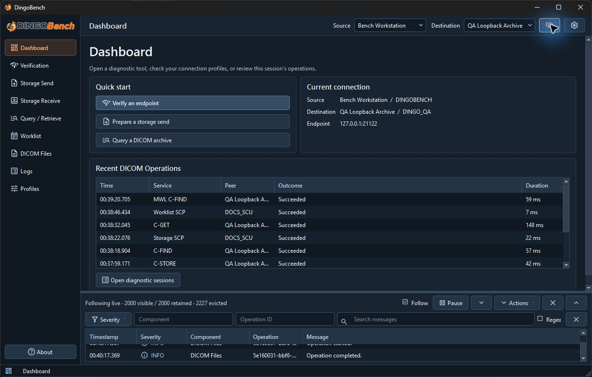
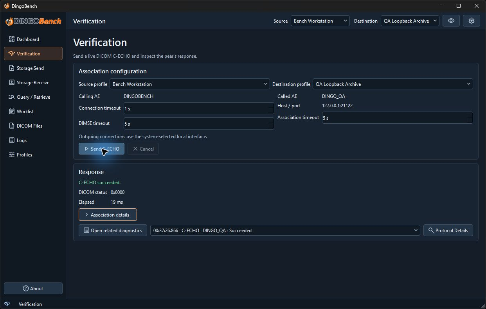
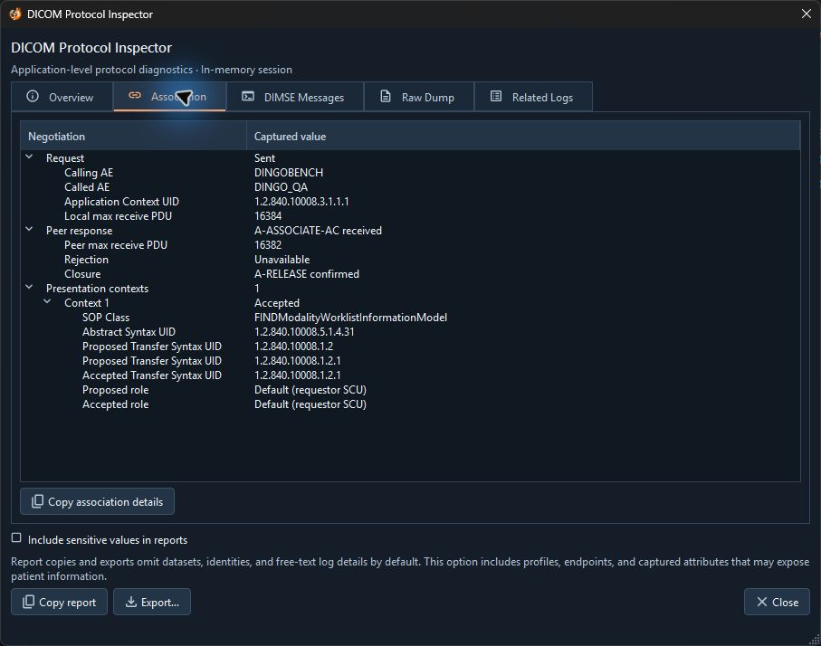
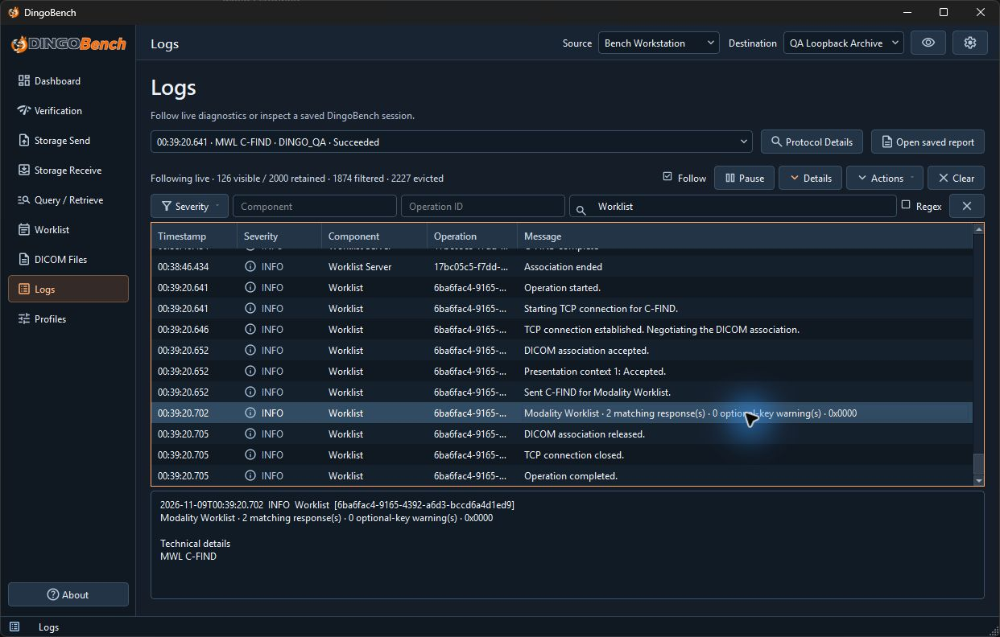

# DingoBench

<div align="center">
  
  <br />
  
</div>

DingoBench is a desktop tool for troubleshooting DICOM connectivity and exchanges. Use it to verify a peer, send and receive DICOM objects, query and retrieve studies, check Modality Worklist, and inspect local DICOM metadata. The Protocol Inspector and logs help trace what happened during an operation.

## Ode to TIANI JDicom

DingoBench was created as a spiritual successor to TIANI JDicom. The original project is no longer maintained, and its official website has disappeared from the live web. We wanted to bring the troubleshooting workflows that made TIANI JDicom useful into a modern Qt desktop application. The DICOM layer uses the widely adopted and actively supported [OFFIS DCMTK toolkit](https://dcmtk.org/en/dcmtk/).

## Downloads and Windows setup

| Platform | Package | Availability |
| --- | --- | --- |
| Windows x64 | Portable ZIP | [Download ZIP](https://github.com/jpdevoto/dingo-bench/releases/download/v0.1.0/DingoBench-0.1.0-windows-x64.zip) |
| Linux x86_64 · Ubuntu 24.04 | DEB | [Download DEB](https://github.com/jpdevoto/dingo-bench/releases/download/v0.1.0/DingoBench-0.1.0-linux-x86_64.deb) |
| Linux x86_64 · Fedora 44 | RPM | [Download RPM](https://github.com/jpdevoto/dingo-bench/releases/download/v0.1.0/DingoBench-0.1.0-linux-x86_64.rpm) |
| macOS | macOS build | **Build pending** |

1. Extract the entire Windows x64 ZIP to a local folder.
2. Run `DingoBench.exe` from that folder. Keep the DLLs and resource folders alongside the executable.

See the [Portable Windows guide](docs/PORTABLE.md) for details.

## Verify a peer and run DICOM operations

The sidebar opens each tool. The **Source** and **Destination** selectors in the top bar set the local identity and remote peer for outbound operations.



*The Dashboard shows the selected profiles, recent operations, and the live diagnostic console.*

1. Open **Profiles → Destination profiles**, select **New**, and enter the peer’s Called AE title, hostname or IP address, and TCP port.
2. Select the destination in the top bar and confirm the **Source** uses the Calling AE title expected by the peer.
3. Open **Verification** and choose **Send C-ECHO**. A successful DICOM response shows status `0x0000`.



*The loopback QA peer answered C-ECHO with status `0x0000`. Check storage, retrieval, and worklist separately because each service negotiates its own capabilities.*

| Task | Tool |
| --- | --- |
| Validate and transfer DICOM Part 10 files, then check the result for each object | [Storage Send](docs/storage-send.md) |
| Start a temporary listener and confirm which incoming objects were saved | [Storage Receive](docs/storage-receive.md) |
| Find Study Root records and retrieve a study or series with C-MOVE or C-GET | [Query / Retrieve](docs/query-retrieve.md) |
| Query scheduled procedure steps or serve existing worklist records | [Modality Worklist](docs/modality-worklist.md) |
| Inspect file metadata, DICOM tags, and nested sequences locally | [DICOM Files](docs/dicom-files.md) |

See [Getting started](docs/getting-started.md) for the first connection walkthrough and the [user guide](docs/README.md) for the complete tool index.

## Inspect protocol details and logs

In **Logs**, select a diagnostic session and open **Protocol Details**. Use **Association** to check the negotiation outcome and compare proposed and accepted transfer syntaxes. In **DIMSE Messages**, select a request or response to inspect its command set, status details, and any captured dataset.



*The peer accepted the Modality Worklist presentation context with Explicit VR Little Endian.*

Use **Related Logs** in the inspector to see retained events for that session. In the **Logs** workspace, filter by severity, component, or operation ID, or search message text. Select an event and open **Details** to see its full message and any technical details.



*The Worklist search shows the selected C-FIND completion event, including the match count and final status.*

See [Protocol Inspector](docs/protocol-inspector.md), [Logs and diagnostics](docs/logs-and-diagnostics.md), and [Troubleshooting](docs/troubleshooting.md). Use approved DICOM endpoints and review copied or exported diagnostics for sensitive data before sharing them.

## Build from source

On Windows, use an x64 Visual Studio 2022 developer PowerShell with the MSVC C++ toolchain and Windows SDK. Install CMake 3.22 or later, Ninja, Python 3.10 or later, and Qt 6 for MSVC x64 with Qt Base and Qt SVG. CI uses Qt 6.11.3. The build requires DCMTK 3.7.1, which the helper script builds from verified upstream source.

Run these commands from the repository root. Adjust `Qt6_ROOT` to match your Qt installation.

```powershell
$env:Qt6_ROOT = 'C:\Qt\6.11.3\msvc2022_64'
python scripts/build_dcmtk.py --work build/dcmtk
cmake --preset ci-release `
    "-DDCMTK_ROOT=$PWD/build/dcmtk/sdk" `
    "-DDINGOBENCH_DCMTK_TOOLS_DIR=$PWD/build/dcmtk/sdk/bin"
cmake --build --preset ci-release
ctest --preset ci-release
```

The [CI workflow](.github/workflows/ci.yml) builds and tests on Windows and Linux. The [release workflow](.github/workflows/release.yml) tests the Windows ZIP, Ubuntu DEB, and Fedora RPM before attaching them to a draft release.

## Directory layout

| Path | Contents |
| --- | --- |
| `src/`, `include/` | Qt application, DICOM services, and headers |
| `tests/` | Automated tests and integration checks |
| `assets/` | Application branding, icons, and bundled visual assets |
| `docs/`, `screenshots/` | User guides and captures from the running app |
| `scripts/`, `.github/workflows/` | Dependency, packaging, and CI tooling |

## License and notices

DingoBench code is licensed under GPL-3.0-only. The DingoBench name, mascot, wordmarks, logos, and application icons are outside the GPL grant for the code and have separate branding terms. Bundled third-party components retain their own licenses.

[GPL-3.0-only license](LICENSE) · [Branding terms](BRANDING.md) · [Third-party notices](docs/licenses/README.md)
