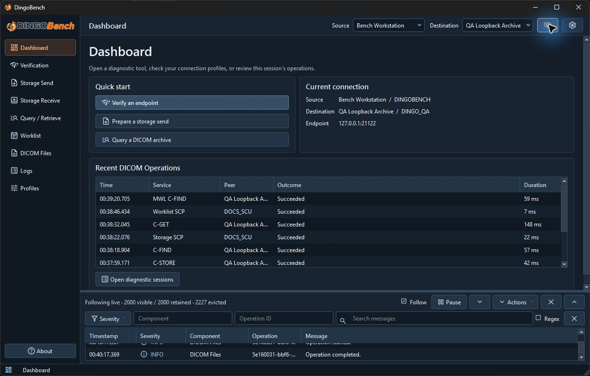

# DingoBench user guide

DingoBench is a desktop tool for investigating DICOM connectivity, storage, query, retrieval, and Modality Worklist behavior. Use it to compare what a peer reports with what the application negotiated, received, or saved.

| Task | Guide |
| --- | --- |
| Open the application and verify a peer | [Getting started](getting-started.md) |
| Find a tool or adjust the workspace | [Interface overview](interface-overview.md) |
| Define local and remote DICOM identities | [Profiles](profiles.md) |
| Check whether a peer answers DICOM Verification | [Verification](verification.md) |
| Send selected DICOM objects | [Storage Send](storage-send.md) |
| Accept incoming DICOM objects | [Storage Receive](storage-receive.md) |
| Find studies and retrieve objects | [Query / Retrieve](query-retrieve.md) |
| Query a worklist or host a temporary worklist server | [Modality Worklist](modality-worklist.md) |
| Inspect attributes in a local file | [DICOM Files](dicom-files.md) |
| Examine association and DIMSE details | [Protocol Inspector](protocol-inspector.md) |
| Filter, save, or reopen diagnostic records | [Logs and diagnostics](logs-and-diagnostics.md) |
| Investigate a failure by phase or service | [Troubleshooting](troubleshooting.md) |
| Use the portable Windows ZIP | [Portable Windows guide](PORTABLE.md) |
| Review license terms for bundled components | [Third-party notices](licenses/README.md) |

Use authorized endpoints and data. DICOM network tools use plain TCP. Files, result tables, copied attributes, and exported diagnostics may contain patient information or identifiers.
