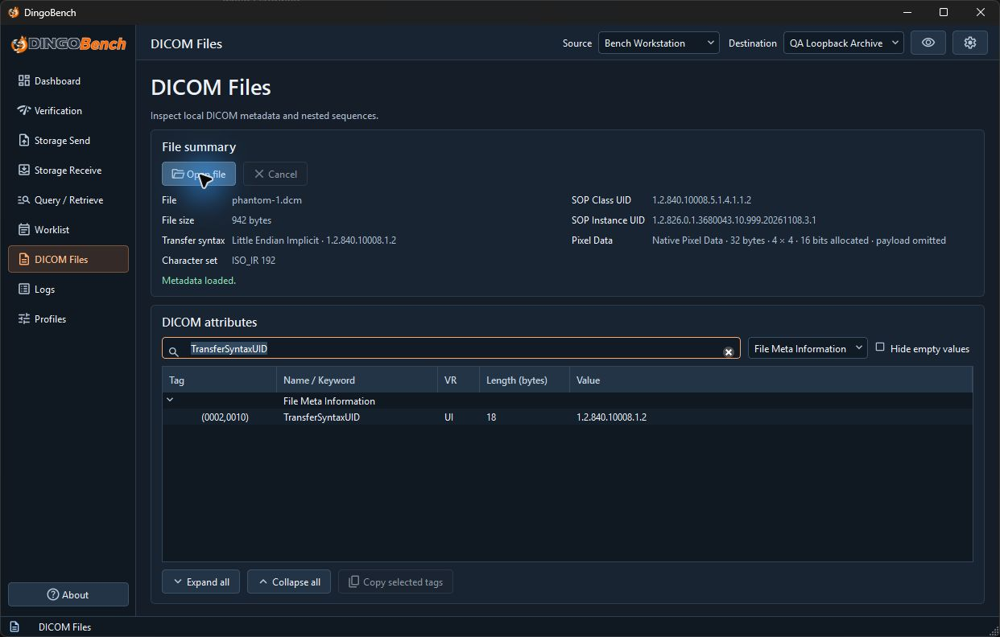

# DICOM Files

Use **DICOM Files** to inspect metadata without sending or editing a local file.

1. Open **DICOM Files** and select **Open file**. Choose the DICOM file. **Cancel** can interrupt inspection while it is running.
2. Review **File summary** for size, transfer syntax, character set, SOP Class UID, SOP Instance UID, Pixel Data, and any issues.
3. Under **DICOM attributes**, select **All elements**, **File Meta Information**, or **Dataset**. Expand sequence and item rows to inspect nested values.
4. Use **Tag number or keyword** to search. For a tag number, use a form such as `(0010,0010)`, `0010,0010`, or `00100010`. Use **Hide empty values** to omit empty rows.
5. Select rows and use **Copy selected tags** to copy the displayed tag, name or keyword, VR, length, and value. Treat the clipboard as sensitive.

Select **File Meta Information** and search for `TransferSyntaxUID` to find the transfer syntax tag alongside the file summary.

The inspector summarizes Pixel Data instead of displaying images. Large, binary, deferred, or otherwise unavailable values may be represented by a summary. If dataset stream compression prevents safe deferred reading, the inspector may show only File Meta Information and explain why. An issue or display limit can make the view incomplete. The original file is read-only.
