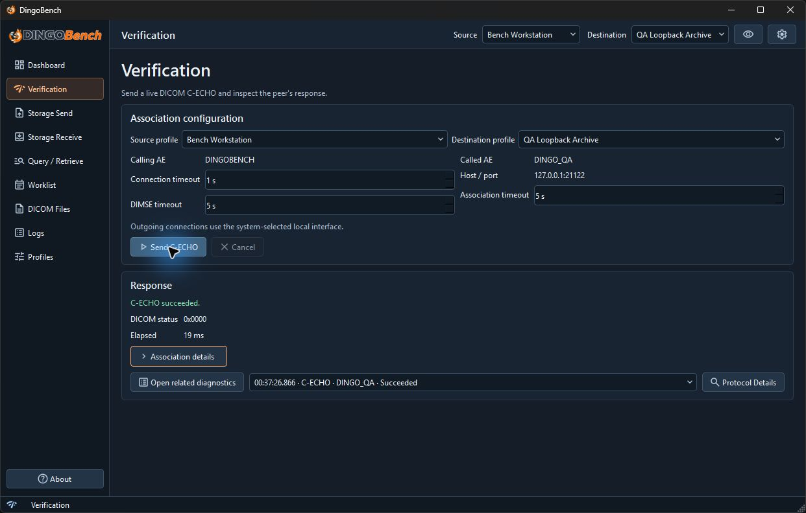

# Getting started

## Open DingoBench

On Windows x64, extract the complete portable ZIP to a local folder and launch **DingoBench.exe**. Keep its companion files and folders together. See [Portable Windows guide](PORTABLE.md) for package-specific details. In the application, **About** shows the installed version, and **Dependencies** shows the runtime and dictionary status.

## Verify your first peer

1. Obtain the peer's Called AE title, hostname or IP address, and TCP port. Confirm that the peer accepts your Calling AE title and offers DICOM Verification.
2. Open **Profiles** → **Destination profiles**. Select **New**, enter the endpoint, and save it.
3. Select the new **Destination** in the top bar. Confirm the **Source** matches the identity registered with the peer. A fresh installation has a local **Bench Workstation** profile with Calling AE title **DINGOBENCH** and no destination.
4. Open **Verification**. Check **Calling AE**, **Called AE**, and **Host / port**, then select **Send C-ECHO**.
5. In **Response**, look for a successful result and DICOM status `0x0000`. For a failure, select **Open related diagnostics** and inspect the operation in **Logs**.

A successful echo verifies that the peer answered this DICOM request. Check storage, worklist, and query or retrieval separately because those services negotiate their own capabilities.

## Choose the next tool

Use [Storage Send](storage-send.md) for outbound objects, [Storage Receive](storage-receive.md) for inbound objects, [Query / Retrieve](query-retrieve.md) for a Study Root archive, or [Modality Worklist](modality-worklist.md) for scheduled procedure steps. Use [DICOM Files](dicom-files.md) to inspect a local file without a network connection.
