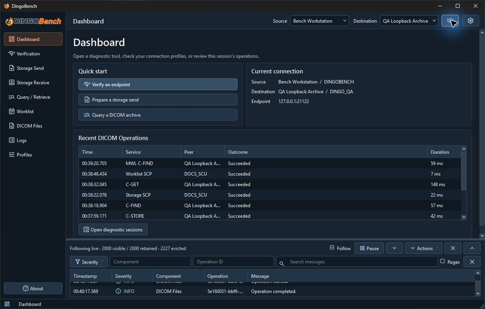

# Interface overview

The Dashboard shows the active connection and recent operations. The compact console is open at the bottom in this example.

- **Dashboard** shows **Quick start**, **Current connection**, and **Recent DICOM Operations**. Recent operations come from completed diagnostic sessions retained in the current run. Use **Open diagnostic sessions** to go to **Logs**.
- The sidebar opens **Verification**, **Storage Send**, **Storage Receive**, **Query / Retrieve**, **Worklist**, **DICOM Files**, **Logs**, and **Profiles**. The **Worklist** workspace has separate **Query** and **Server** tabs.
- **Source** and **Destination** in the top bar select the active profiles shared across workspaces. A page with its own profile selector reflects the corresponding active profile. Some actions require a destination or a valid selection before they are enabled.
- The diagnostic console control in the top bar opens a compact log view. Use **Logs** for the full event table and diagnostic sessions.
- Open the gear control labeled **DingoBench settings** for **Detailed Dataset Capture**, **Clear retained protocol sessions**, and **Reset workspace layout**. Window geometry, console layout, and the last workspace are saved locally.
- **About** shows the version and license. **Dependencies** reports the Qt runtime, DCMTK version, loaded dictionary status, and association parameter probe.
