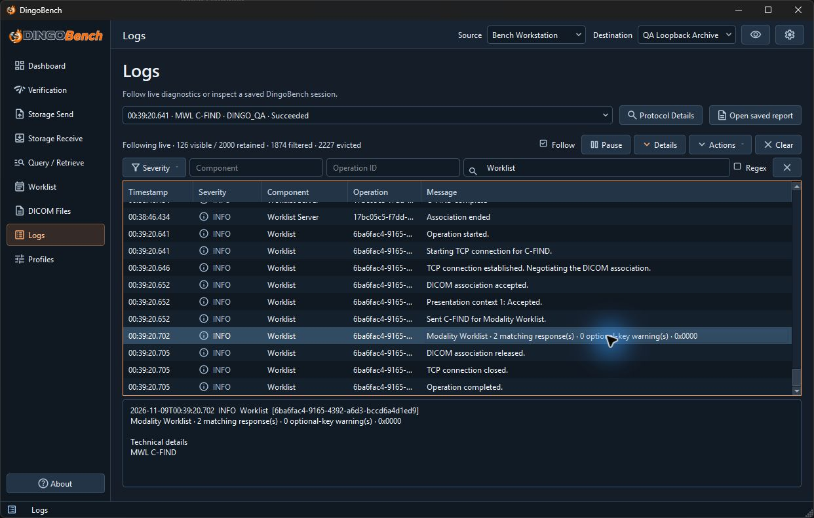

# Logs and diagnostics

Use **Logs** for application events and diagnostic sessions. The compact diagnostic console shows the same live event stream and has its own display controls.

## Inspect live events

- Use **Severity** to show or hide DEBUG, INFO, WARNING, and ERROR events.
- **Component** and **Operation ID** match the full corresponding fields case-insensitively. **Search messages** searches message, component, and operation text. **Regex** interprets that search as a case-insensitive regular expression. If an expression is invalid, the view reports the error and skips the text filter.
- **Follow** keeps the live view at the end. Scrolling away turns it off. **Pause** freezes the view while the logger continues collecting. Select **Resume** to catch up.
- Select a row and open **Details** to inspect the event. The context menu offers **Copy selected message**, **Copy selected events**, and **Copy visible events**.

This live view searches for `Worklist` with DEBUG events hidden. The selected result shows the match count and final status in **Details** while **Follow** remains enabled.

The live logger retains up to 2,000 events in memory and discards the oldest as needed. The status line reports retained, visible, and omitted records as applicable. **Clear** clears retained live events or closes the displayed saved session. Use **Clear retained protocol sessions** in settings to clear the separate protocol history.

## Save and reopen events

1. Open **Actions** and choose **Export all retained…**, **Export filtered…**, or **Export selected…**.
2. Save as **JSON Lines** (`.jsonl`) or **Plain text** (`.txt`). **Include technical details in exports** adds event details and is off by default. The ordinary message and operation fields can still reveal sensitive information. Check exported and copied content before sharing.
3. To review a DingoBench event export, use **Actions** → **Open saved session…**. Use **Return to live session** to switch back. DingoBench opens its own export format.

Use the session selector and **Protocol Details** for association and DIMSE information. Use **Open saved report** for a protocol report, as described in [Protocol Inspector](protocol-inspector.md).
