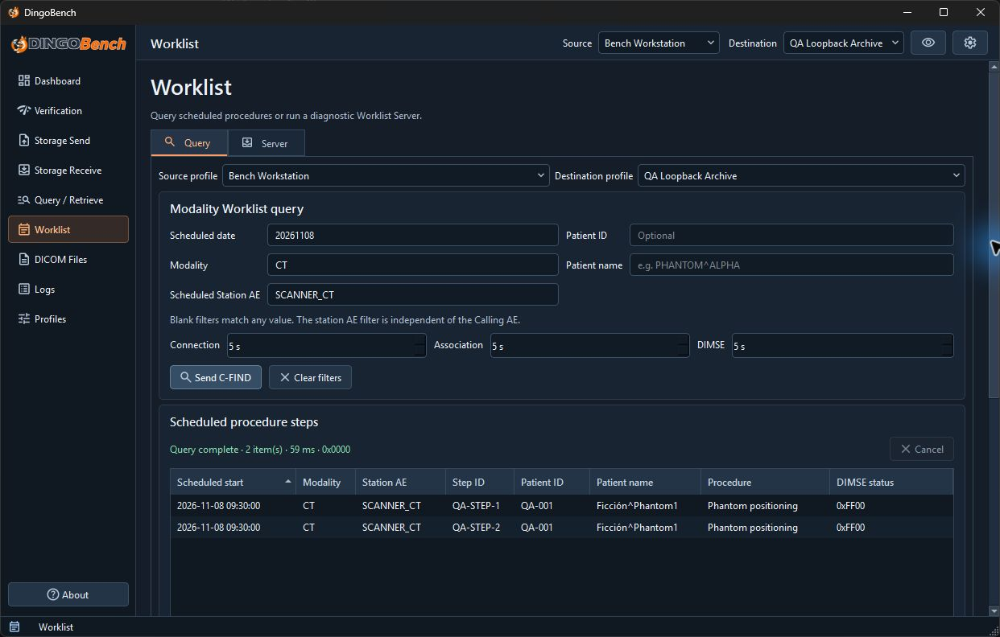
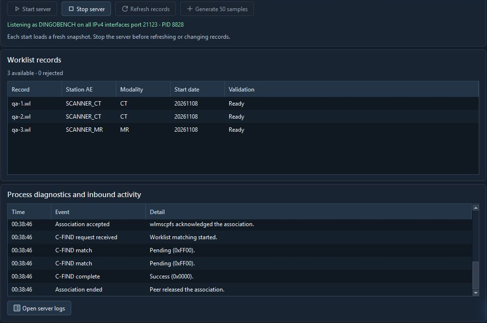

# Modality Worklist

Open **Worklist** and select **Query** to check a remote worklist or **Server** to serve existing records temporarily.

## Query a worklist

1. In **Query**, select the local **Source** and the remote **Destination**. The peer must offer Modality Worklist C-FIND.
2. Enter **Scheduled date**, **Modality**, **Scheduled Station AE**, **Patient ID**, or **Patient name** as needed. Blank fields match any value. The station AE is independent of the Calling AE.
3. Enter dates as `YYYYMMDD` or an ascending range such as `20260101-20260131`. Use one uppercase modality code and an exact station AE title. **Connection**, **Association**, and **DIMSE** default to 5 seconds and accept 1–60 seconds.
4. Select **Send C-FIND**. Use **Clear filters** to reset criteria or **Cancel** to request interruption.
5. Review **Scheduled procedure steps** and the final status. Select a row and choose **Inspect dataset** to review captured attributes, including nested Scheduled Procedure Step information. Use **Protocol Details** for the associated exchange.

This query filters by date, CT modality, and the `SCANNER_CT` station. The peer returned two scheduled steps and a successful final response.



For a closer look at what the peer returned, see the [nested response dataset](protocol-inspector.md#inspect-a-worklist-exchange) in the Protocol Inspector.

Successful completion with no rows means the peer returned no matches. The query view retains up to 250 matches. Narrow the date or station filters if the result limit is reached.

## Generate sample records

With the server stopped, select a writable **Worklist files** folder and choose **Generate 50 samples**. If the folder field is empty, DingoBench asks you to choose one. Each click adds 50 new synthetic `.wl` files and refreshes **Worklist records**. Choose a dedicated local sample folder to keep the generated records separate from imported records. The folder must have room for the full batch within the 500-record limit.

Each batch includes CT, MR, US, CR, and DX steps scheduled for yesterday, today, and tomorrow, based on the computer's local date when you generate them. After starting the server, try a query with today's **Scheduled date**, **Modality** set to `CT`, and **Scheduled Station AE** set to `SCANNER_CT`. The other modalities use the same station naming pattern, such as `SCANNER_MR`.

## Create a worklist record

Save the following synthetic example as plain text named `example.dump` in a local folder. Use synthetic data when testing the server.

```text
(0010,0010) PN [Phantom^Example]
(0010,0020) LO [TEST-001]
(0008,0050) SH [ACC-001]
(0020,000d) UI [2.25.145620721293049926522754712922930661001]
(0032,1060) LO [Phantom calibration]
(0040,1001) SH [REQ-001]
(0008,1110) SQ
(fffe,e0dd) na
(0008,1120) SQ
(fffe,e0dd) na
(0040,0100) SQ
  (fffe,e000) na
    (0040,0001) AE [SCANNER_CT]
    (0040,0002) DA [20261103]
    (0040,0003) TM [093000]
    (0008,0060) CS [CT]
    (0040,0007) LO [Scan calibration phantom]
    (0040,0009) SH [STEP-001]
  (fffe,e00d) na
(fffe,e0dd) na
```

Open a terminal in that folder and run the following command. Use `dump2dcm` from a separate DCMTK installation. The portable DingoBench package includes the server utility `wlmscpfs`, while record conversion uses `dump2dcm`. [DCMTK converter reference](https://support.dcmtk.org/docs/dump2dcm.html)

```sh
dump2dcm -F +te "example.dump" "example.wl"
```

The command writes `example.wl` as a binary DICOM dataset in Explicit VR Little Endian. For a second synthetic patient and study, save a copy as `example-2.dump`. Change the patient name and ID, accession number, Study Instance UID, requested procedure ID, and scheduled step ID. Convert it to `example-2.wl` using the same command with the new filenames. Change the date, modality, or station AE if you want to test different filters.

In **Worklist → Server**, point **Worklist files** at the folder containing `example.wl`. Select **Refresh records** and confirm the file is accepted in **Worklist records**. Start the server using the steps below.

To query the example from the same computer, set up a Destination Profile with host `127.0.0.1`, the server's **Called AE Title**, and its **Listening port**. Start the server with **IPv4** for this loopback example. In **Worklist → Query**, choose that destination and set **Scheduled date** to `20261103`, **Modality** to `CT`, and **Scheduled Station AE** to `SCANNER_CT`. Select **Send C-FIND**. The results should include patient ID `TEST-001` and step ID `STEP-001`.

## Serve worklist records

1. Open **Server** and select a **Source Profile**. Review the **Called AE Title** and set **Listening port**.
2. Set **Worklist files** to an existing directory of `.wl` records. The directory can contain at most 500 records, each no larger than 1 MiB. Select **Refresh records** to check them without starting the server, then review accepted and rejected records in **Worklist records**.
3. Check **wlmscpfs executable**. The portable Windows package includes it. Use **Browse** to choose an installed copy if the field is empty or the location has changed.
4. Select **IPv4** or **IPv6** under **Address family**. The server listens on all interfaces in that family. The source profile's bind setting cannot restrict it to a single address. Enable **Allow listening on all interfaces of this address family** only when that exposure is appropriate.
5. Select **Start server**. At least one valid record is required. Check **Process diagnostics and inbound activity**, or use **Open server logs** to inspect events in **Logs**.
6. Select **Stop server** when finished. To inspect changed records, stop the server and use **Refresh records**. Start again to serve the updated set. The server uses a snapshot of the accepted records and leaves the originals in place.

The server shows three ready records. Its inbound activity lists two pending matches followed by a successful final response.



This server is for diagnostic worklist queries. It does not create schedules, edit records, or manage a RIS database. Inbound protocol detail depends on what the server utility reports.
