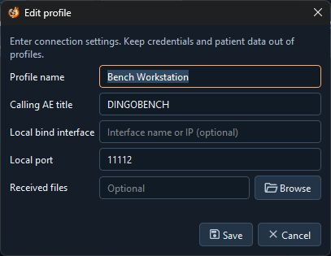
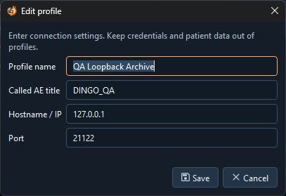

# Profiles

A source profile identifies DingoBench. A destination profile identifies a remote DICOM peer.

## Create or change a profile

1. Open **Profiles** and choose **Source profiles** or **Destination profiles**.
2. Select **New**, or select a row and choose **Edit** or **Duplicate**.
3. Fill in the fields and select **Save**. If a field is rejected, correct it before closing the editor.
4. Select a row and choose **Use profile**, or use the **Source** or **Destination** selector in the top bar.

The source editor contains the Calling AE title and local listener defaults.

The destination editor contains the Called AE title and the remote TCP endpoint.

| Field | How DingoBench uses it |
| --- | --- |
| **Profile name** | A display label of up to 48 characters. |
| **Calling AE title** | The source identity used in outgoing associations. The same profile AE title identifies local listeners when selected there. |
| **Local bind interface** | Optional address or interface name for **Storage Receive**. A blank setting uses IPv4 loopback in that tool. **Worklist Server** uses its own address-family setting. Outgoing associations use the system-selected interface. |
| **Local port** | A listening port for local services. It does not pin the source TCP port of outgoing connections. |
| **Received files** | Fills the receive directory when a source is selected in **Storage Receive**. **C-GET** takes its initial directory from the active source at startup. Check the displayed directory before receiving. |
| **Called AE title** | The identity the remote peer expects in an outgoing association. |
| **Hostname / IP** | A hostname, IPv4 address, or IPv6 address. Enter the address without a URL scheme or port. |
| **Port** | The remote TCP port. Local and remote ports must be in the range 1–65535. |

AE titles must be 1–16 printable ASCII characters without backslashes. Use the exact AE titles expected by the peer.

A fresh installation starts with **Bench Workstation**, **DINGOBENCH**, local port **11112**, a blank bind interface and received-file directory, and no destination profiles. The new-destination form starts at port **104**. Replace it with the port supplied by the peer administrator if it differs. Profiles and active choices are saved locally. You can delete the last destination, but at least one source must remain. If a profile file cannot be read or uses an unsupported version, DingoBench reports the problem and makes defaults available.
