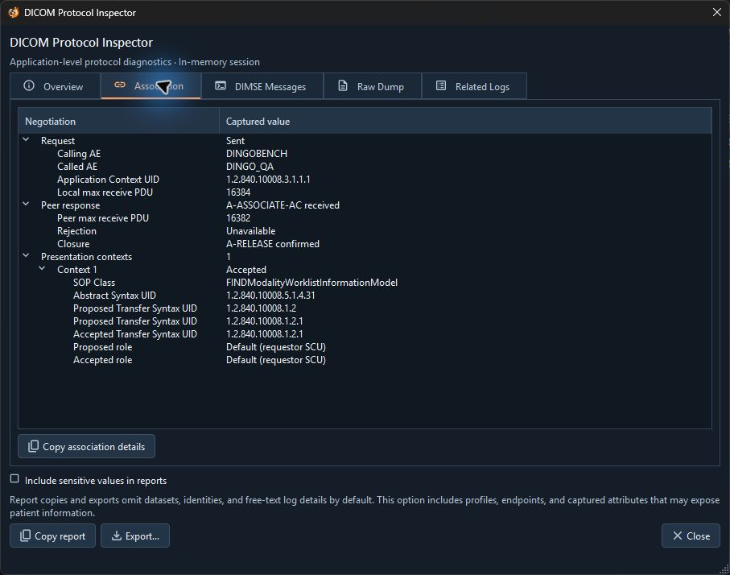
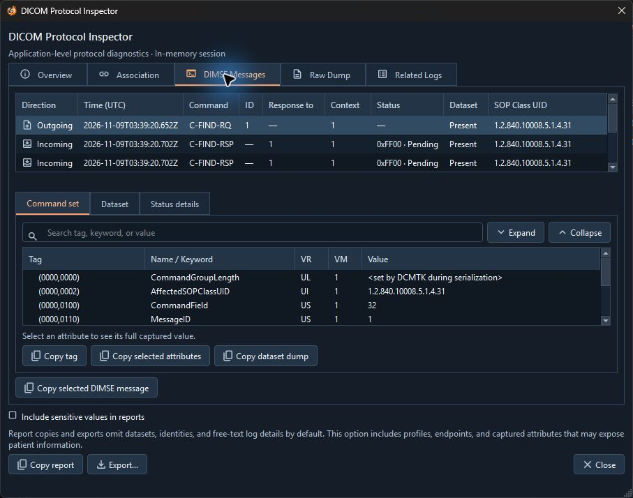
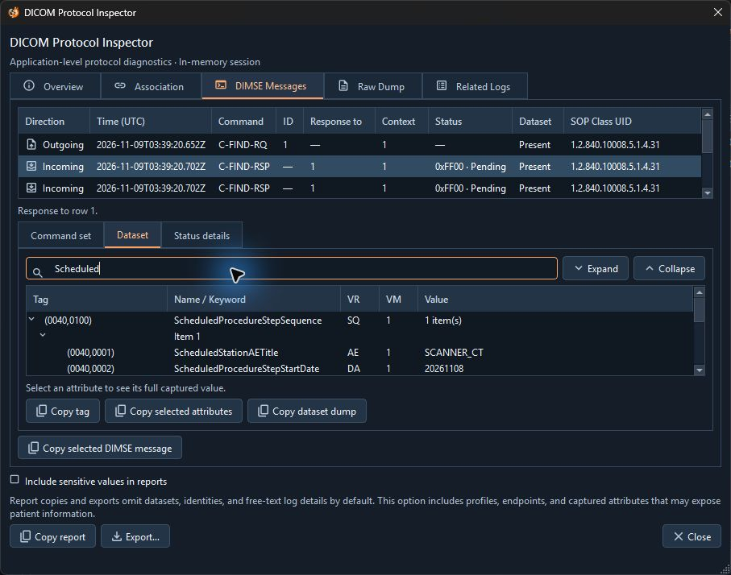

# Protocol Inspector

Use the Protocol Inspector to review what DingoBench observed during an operation. It records application-level protocol information, with coverage depending on the service and the exchange. It does not capture network packets.

## Open a session

In **Logs**, select a diagnostic session and choose **Protocol Details**. Some tool pages also offer the session selector. DingoBench retains up to eight recent sessions in memory. **DingoBench settings** → **Clear retained protocol sessions** clears the session list.

| Tab | What to review |
| --- | --- |
| **Overview** | Result, timing, identities, capture mode, and available status information. |
| **Association** | Connection and negotiation outcome, endpoints, presentation contexts, and transfer syntax where captured. |
| **DIMSE Messages** | Captured commands and responses. Select a row and inspect **Command set**, **Dataset**, or **Status details**. |
| **Raw Dump** | Text rendering of the session at the current report sensitivity setting. |
| **Related Logs** | Events correlated with this session that remain available. |

An unavailable value means the application did not capture or receive it. A bounded capture can omit older messages or truncate datasets. Inbound Worklist Server details can be limited to utility diagnostics.

## Inspect a Worklist exchange

In **Association**, expand **Presentation contexts** to compare the proposed transfer syntaxes with the one the peer accepted.

In **DIMSE Messages**, select the outgoing **C-FIND-RQ** to read its **Command set**. The incoming **C-FIND-RSP** rows link back to the request through **Response to**.

Select a pending response with a dataset and open **Dataset**. Search for `Scheduled` and expand the sequence to see the station AE and start date under the returned item.

## Capture and share details

**Detailed Dataset Capture** is off by default. Enable it under **DingoBench settings** before repeating an operation if you need attribute values for a supported exchange. Enabling it cannot recover values from previous sessions. Returned query results have their own **Inspect dataset** control.

Use **Copy report** or **Export…** for a text or JSON report. The default report omits sensitive fields and dataset values. **Include sensitive values in reports** can expose profiles, endpoints, and captured values. Review the report before sharing it. Direct copy actions in dataset inspectors can copy displayed values independently of the report setting.

Use **Logs** → **Open saved report** to read a DingoBench diagnostic report. This opens a read-only report viewer. Event log exports use **Open saved session…** instead.
