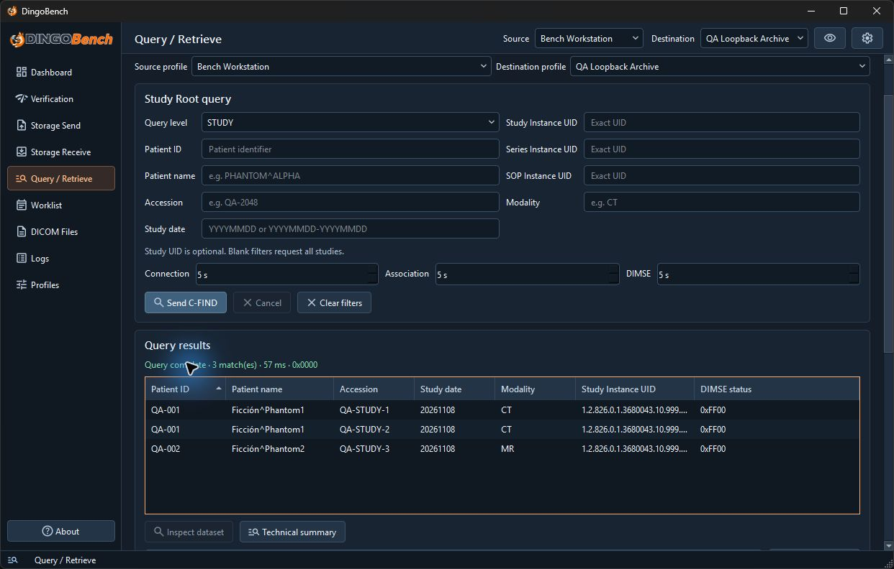
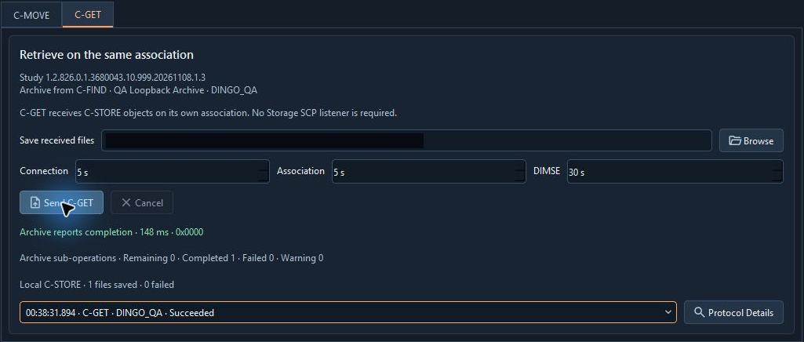

# Query / Retrieve

Use **Query / Retrieve** to send Study Root C-FIND requests and retrieve a selected study or series. The remote archive must support the specific service you select.

## Find records

1. Select **Source** and **Destination**.
2. Under **Study Root query**, choose **Query level** and enter the applicable filters.

| Level | Criteria |
| --- | --- |
| **STUDY** | **Patient ID**, **Patient name**, **Accession**, **Study date**, **Study Instance UID**, and **Modality** are optional. Blank filters request all studies. |
| **SERIES** | Enter an exact **Study Instance UID**. **Series Instance UID** and **Modality** are optional. |
| **IMAGE** | Enter exact **Study Instance UID** and **Series Instance UID** values. **SOP Instance UID** is optional. |

Use `YYYYMMDD` or an ascending date range such as `20260101-20260131`, and a single uppercase modality code such as `CT`. Use exact UIDs without wildcards. **Connection**, **Association**, and **DIMSE** default to 5 seconds and accept 1–60 seconds.

3. Select **Send C-FIND**. Use **Clear filters** to reset the criteria or **Cancel** to request cancellation.
4. In **Query results**, review the final status and match count. Select a row and choose **Inspect dataset** for the captured response attributes, or open **Technical summary** and **Protocol Details**.

The result summary shows final status `0x0000`. The table lists the pending `0xFF00` responses that carried each study.

Successful completion with zero matches differs from a failed request. Pending responses can carry matching datasets and warnings about optional keys. DingoBench retains up to 250 matches per query. Narrow the criteria if the result limit is reached.

## Retrieve with C-MOVE

1. Select a STUDY or SERIES result, then open **C-MOVE** below the query results. Retrieval uses the archive from that result. Run C-FIND again to use another archive or if the destination profile used for the result was deleted.
2. Set **Move target** to **Local Storage SCP** or **Other move destination**. For the local option, use **Open Storage Receive**, configure and start the listener, then return to C-MOVE. For another receiver, enter its **Move Destination AE**.
3. Confirm the archive maps that AE title to the receiver's reachable address and port. The archive opens a separate C-STORE association to that target.
4. Select **Send C-MOVE**. Compare the archive's sub-operation counts and final status with receiver events. Local receipts appear separately when DingoBench can correlate them.

An archive can report success for delivery to a different receiver. For a local move, verify **Storage Receive** actually saved the files. If cancellation is unacknowledged, the archive may continue sending objects.

## Retrieve with C-GET

1. Select a STUDY or SERIES result and open **C-GET**. As with C-MOVE, run another C-FIND to choose a different archive.
2. Set **Save received files** to an existing writable directory, using **Browse** if needed.
3. Select **Send C-GET**. The archive sends C-STORE sub-operations back on the same association. You do not need to start **Storage Receive**.
4. Review the archive counts and final status alongside **Local C-STORE** counts. Inspect the selected session with **Protocol Details** if negotiation or saving failed.

The archive reported one completed sub-operation, and **Local C-STORE** confirmed one file saved. The local directory is redacted.

C-GET requires compatible storage presentation contexts and role negotiation. DingoBench proposes uncompressed storage transfer syntaxes for C-GET and applies a 64 MiB wire limit per object. Saved files remain after cancellation.

For both retrieval tabs, **Connection** and **Association** default to 5 seconds, and **DIMSE** defaults to 30 seconds. Each accepts 1–60 seconds. **Cancel** requests cancellation. Individual IMAGE results cannot be retrieved from these tabs.
