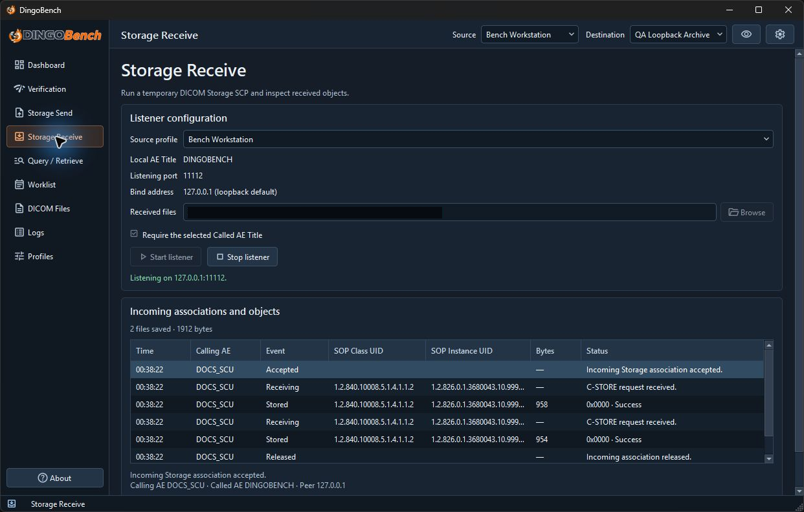

# Storage Receive

Use **Storage Receive** to run a temporary DICOM Storage SCP and check which incoming objects were actually saved.

1. Choose a **Source profile** and review **Local AE Title**, **Listening port**, and **Bind address**.
2. Set **Received files** to an existing writable directory. **Browse** opens the directory picker.
3. Leave **Require the selected Called AE Title** checked to reject associations addressed to another Called AE. It is checked by default.
4. Select **Start listener**. Wait for the listening status, then send from the peer to the displayed AE, address, and port.
5. Watch **Incoming associations and objects**. Select a row to see details. Use **Open saved dataset** on a saved object or **Open related diagnostics** to filter the log.
6. Select **Stop listener** when finished. Saved files remain in the selected directory.

In this example, the listener is active on loopback and the event table shows two **Stored** rows. The local directory is redacted.

Blank bind uses `127.0.0.1`, which is accessible only from the same machine. For a remote sender, choose an interface or local address reachable from that peer and confirm the network and firewall permit inbound traffic. A bind failure can indicate a port already in use or an unavailable address.

The listener saves objects under generated `.dcm` filenames and refuses to overwrite existing files. Check the saved count and event status rather than relying on the association outcome alone. Incoming objects exceeding the 64 MiB wire limit are rejected. This is a diagnostic receiver with no archive database or retention workflow.
