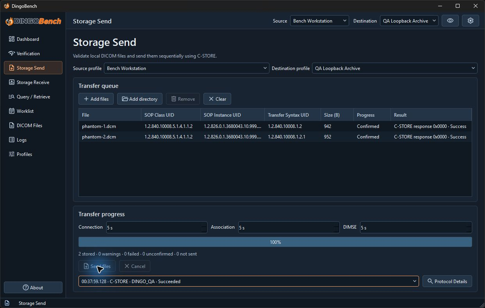

# Storage Send

Use **Storage Send** to validate local DICOM Part 10 files and send them to a peer that accepts DICOM Storage.

1. Select the **Source** and **Destination**.
2. In **Transfer queue**, select **Add files** or **Add directory**. Directory selection scans the chosen directory without descending into subdirectories. The queue holds up to 1,000 entries.
3. Review the validation results, SOP Class UID, SOP Instance UID, transfer syntax, and size. Use **Remove** for selected entries or **Clear** to empty the queue.
4. In **Transfer progress**, review **Connection**, **Association**, and **DIMSE**. They default to 5 seconds each and accept 1–60 seconds.
5. Select **Send files**. Follow progress and the status of each object. **Cancel** requests interruption of the current operation.

In this transfer, both files show **Confirmed** with status `0x0000`. The summary below the progress bar reports two stored objects.

The final summary separates stored, warning, failed, unconfirmed, and not-sent objects. A warning needs review. An unconfirmed result means DingoBench did not receive confirmation, so check the peer before retrying. Open **Protocol Details** for the C-STORE session to review presentation contexts and per-object status.

DingoBench offers the file's original transfer syntax for its SOP Class and does not transcode or change source files. If the peer rejects that combination, the object cannot be sent through that presentation context.
