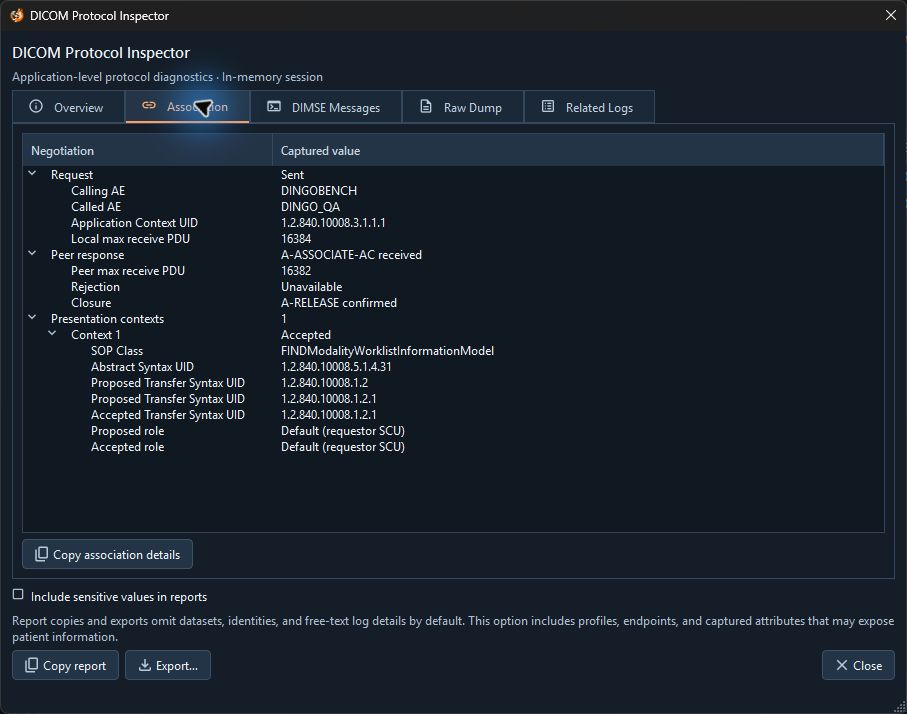

# Troubleshooting

Start with the affected tool's status. Then select the corresponding operation in **Logs** and open **Protocol Details** when a session is available. Preserve relevant results before closing the application or letting newer events replace them.

| Symptom | What to check |
| --- | --- |
| An outbound action is disabled | Choose a **Destination**. Storage Send also needs a validated file. For retrieval, select a STUDY or SERIES result with the required UIDs. |
| Name resolution fails | Check the destination hostname. Enter the port separately in the profile. |
| TCP is refused, unreachable, or times out | Confirm the peer is listening at the configured port and that the network path and firewall permit the connection. Check **Connection timeout** where available. |
| Association is rejected | Compare **Calling AE** and **Called AE** with the peer's registration and policy. Review the rejection in the **Association** tab. |
| Association opens but the service is unavailable | Check the negotiated presentation context for the requested SOP Class and transfer syntax. C-ECHO success does not establish support for other services. |
| DIMSE times out | Inspect the last command or response. Check whether the peer is still processing the request before increasing the relevant timeout or retrying. |
| Storage Send reports unconfirmed or failed objects | Check each object's status. For context rejection, compare the original transfer syntax with what the peer accepts. For an unconfirmed send, verify the peer before resending. |
| An inbound listener cannot start | Check the listening address and port, whether another program holds the port, and the selected directory. Worklist Server also requires an available executable and explicit all-interface permission. |
| A remote sender cannot reach Storage Receive | Blank bind is loopback only. Select a reachable local address or interface and check the firewall and Called AE. |
| C-FIND returns no results | Check the final status before treating it as an error. Verify the selected query level, exact parent UIDs, and matching criteria. |
| C-MOVE reports success but no local files appear | Verify the archive's Move Destination AE mapping, the receiver's listening status, and inbound connectivity. Check receiver events and counts separately from the archive response. |
| C-GET cannot receive objects | Check the archive's C-GET support, storage roles and accepted transfer syntaxes, and the local output directory. Review **Local C-STORE** counts as well as the final archive status. |
| Worklist items are missing | In **Query**, check scheduled date, modality and station AE. In **Server**, review rejected records and restart after changing the source files. |
| An inspector omits values | Review the file's issues or the session's capture mode. Some data is unavailable, deferred, or outside the capture limit. |

Use the accepted association below as a reference. **Peer response** records the negotiation outcome, and the accepted transfer syntax appears inside the negotiated context.

For startup problems with the Windows ZIP, extract a complete copy into a fresh folder and keep all companion files together. If the app opens, **About** → **Dependencies** identifies the installed runtime and reports dictionary availability. When sharing evidence, start with the default protocol report and review it for sensitive information.
