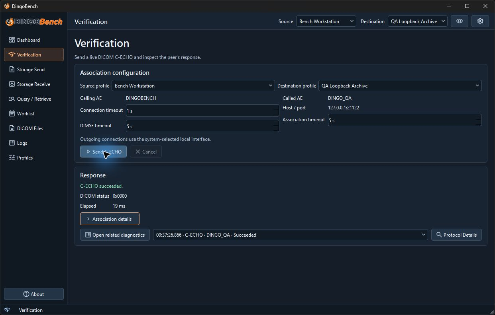

# Verification

Use **Verification** to check whether a peer responds to a DICOM C-ECHO request from your selected Calling AE.

1. Select a [Source and Destination](profiles.md).
2. Review **Calling AE**, **Called AE**, and **Host / port** under **Association configuration**.
3. Set **Connection timeout**, **Association timeout**, and **DIMSE timeout** as needed. Each starts at 5 seconds and accepts 1–60 seconds. These limits apply to different phases of the exchange.
4. Select **Send C-ECHO**. Use **Cancel** if you need to interrupt the attempt.
5. In **Response**, read **DICOM status**, **Elapsed**, and the association details. Select **Open related diagnostics** to see the associated logs.

A successful response has status `0x0000`. A TCP connection alone does not establish success. If no DICOM status was received, use the error and association details to distinguish name resolution, TCP connection, association rejection, presentation context rejection, or a DIMSE timeout. See [Troubleshooting](troubleshooting.md).

## Timeout settings

**Connection** applies to reaching the peer, including name resolution and TCP connection. **Association** applies to DICOM negotiation. **DIMSE** applies to the command and response exchange after negotiation. An operation can take longer than any one of these settings because it can use several phases or exchange several messages.
